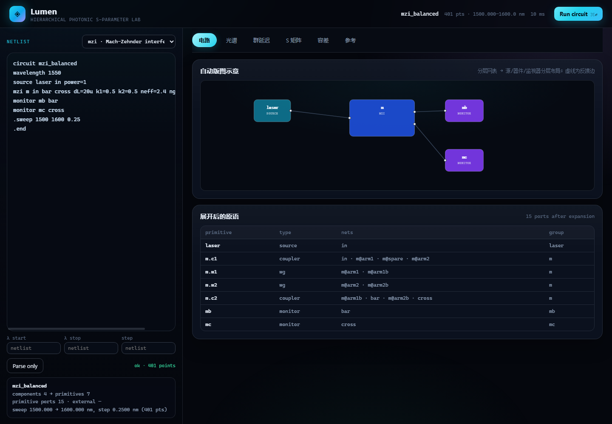
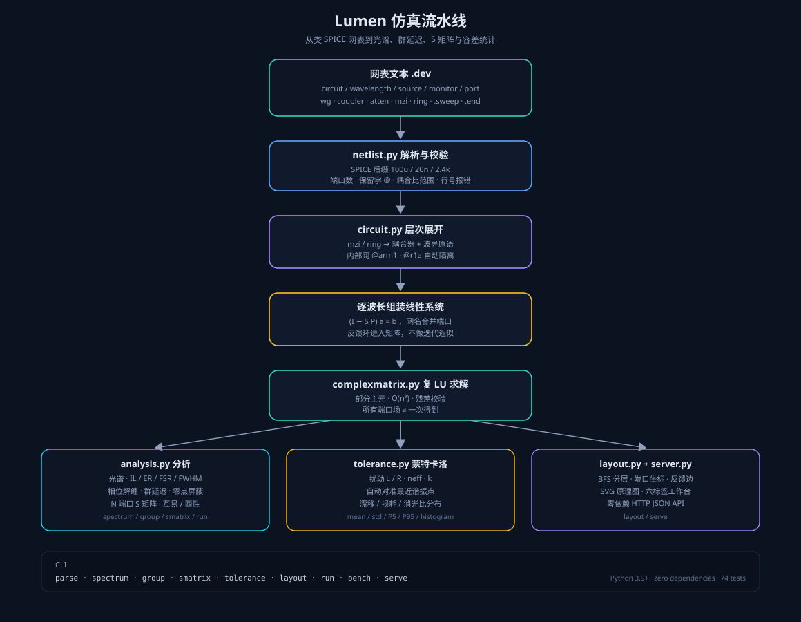
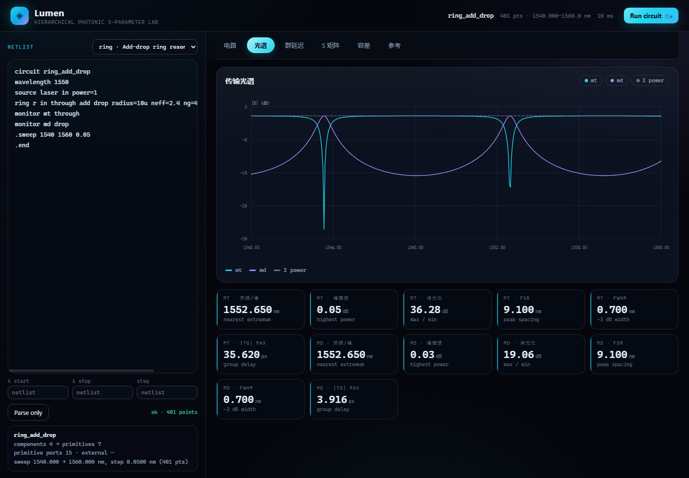
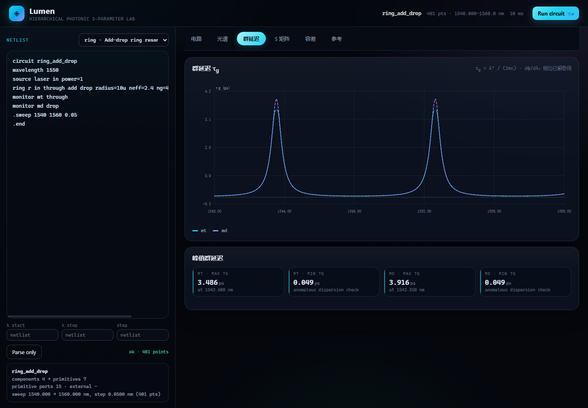
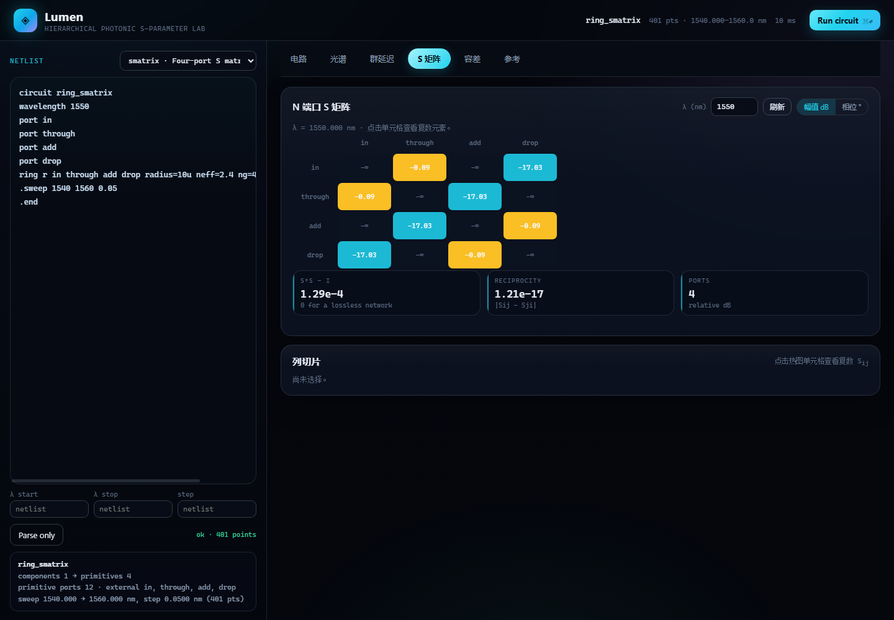
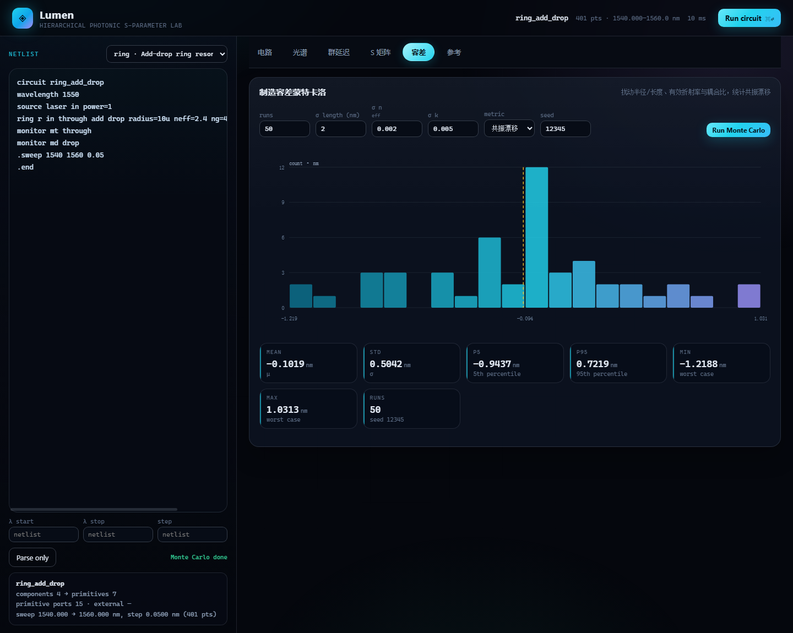

# Lumen

**分层光子集成电路 S 参数仿真器** · Hierarchical photonic integrated circuit S-parameter simulator

[](https://github.com/18971181532/lumen/actions/workflows/tests.yml)
[](https://www.python.org/)
[](LICENSE)
[](pyproject.toml)

Lumen 是一个**零第三方依赖**的本地光子回路仿真器：用类 SPICE 的紧凑网表描述波导、定向耦合器、MZI 与微环，把整个回路组装成复数 S 矩阵线性系统，一次性精确求解所有端口场，再输出光谱、群延迟、N 端口 S 矩阵、制造容差蒙特卡洛和自动版图示意图。

它面向**光电子/硅光方向的学生与早期架构探索**：不依赖 commercial EDA，不需要安装 LU 分解库，`git clone` 后一条命令即可跑起来；同时保留足够严谨的物理约定，可用于课程设计、器件参数扫掠、答辩演示和个人作品集展示。

> 定位是教学级理想模型与设计探索工具，不是流片签核工具。边界见文末。

---

## 为什么值得做

商用光子仿真器（Lumerical INTERCONNECT、Synopsys Photonic Solutions 等）功能完整，但安装重、许可贵、网表与脚本门槛高。Lumen 反过来做三件事：

1. **把回路当成电路来解**：每个器件是一个复数 S 矩阵，端口用网名连接；反馈环不是迭代近似，而是直接进入线性方程组。
2. **把层次化写进语言**：`mzi`、`ring` 是真正的子电路，解析时展开为耦合器与波导原语，用户不必手工拆端口。
3. **把结果闭环到工程指标**：光谱、FSR、FWHM、消光比、群延迟、S 矩阵互易/酉性、容差分布，全部一次算完。

---

## 功能一览

- **层次化网表**：`wg`、`coupler`、`atten`、`source`、`monitor`、`mzi`、`ring` 七类元件；`mzi`/`ring` 自动展开为原语。
- **复数 S 矩阵求解**：自写部分主元 LU，求解 `(I − S P) a = b`；支持任意无源线性网络与反馈环。
- **波长扫描**：峰值/谷值、插入损耗、消光比、FSR、FWHM、中心功率。
- **群延迟**：`τg = λ²/(2πc)·dφ/dλ`，相位自动解缠；在传输零点处屏蔽不可定义的相位。
- **N 端口 S 矩阵**：用 `port <net>` 声明外部端口，导出幅度、dB、相位、互易误差与酉性误差。
- **制造容差蒙特卡洛**：扰动长度/半径、有效折射率、耦合比；统计漂移、损耗、消光比，输出分位数与直方图。
- **自动版图示意图**：BFS 分层布局，源在首列、监视器在末列，反馈边单独标记，导出白底 SVG。
- **CLI + Web 双入口**：9 个子命令，全部支持 `--json`；内置六标签工作台（电路 / 光谱 / 群延迟 / S 矩阵 / 容差 / 参考）。
- **74 个单元与集成测试**：覆盖解析、矩阵、器件、求解、分析、容差、布局、CLI、HTTP、示例。

<p align="center">
  
</p>

---

## 5 分钟上手

要求：**Python 3.9+**，无第三方依赖。

```bash
git clone https://github.com/18971181532/lumen.git
cd lumen

# 直接以模块方式运行，无需安装
python -m lumen --version

# 或者安装为命令（可选）
python -m pip install -e .
lumen --version
```

启动本地工作台：

```bash
python -m lumen serve --port 8864
# 浏览器打开 http://127.0.0.1:8864/
```

工作台支持 URL 直达示例：

```text
http://127.0.0.1:8864/?example=mzi&tab=spectrum
http://127.0.0.1:8864/?example=ring&tab=tolerance&tolerance=1&runs=60
```

---

## 使用示例

### 1. 扫一条 MZI 的光谱

```bash
python -m lumen spectrum examples/mzi.dev
```

```text
mzi_balanced - 401 points, 1500.000 to 1600.000 nm (step 0.25 nm)
monitor      peak_nm    IL_dB    ER_dB    FSR_nm   FWHM_nm   tau_max
mb          1549.000     0.00    49.88     28.62     14.75  0.140 ps
mc          1549.000     0.00    63.85     28.62     14.75  0.140 ps
```

### 2. 群延迟

```bash
python -m lumen group examples/ring.dev --every 20
```

```text
   lambda_nm        mt_ps        md_ps
   1540.0000       0.0551       0.0552
   1540.0500       0.0554       0.0556
   1540.1000       0.0561       0.0563
   1540.1500       0.0569       0.0571
```

### 3. 提取 4×4 S 矩阵

```bash
python -m lumen smatrix examples/smatrix.dev
```

```text
ring_smatrix - S matrix at 1550.000 nm (4 ports)
  |S| (dB)
               in   through       add      drop
in        -600.00     -0.09   -600.00    -17.03
through     -0.09   -600.00    -17.03   -600.00
add       -600.00    -17.03   -600.00     -0.09
drop      -17.03   -600.00     -0.09   -600.00
  phase (deg)
               in   through       add      drop
in            0.0       5.0       0.0     -85.0
...
```

### 4. 制造容差蒙特卡洛

```bash
python -m lumen tolerance examples/tolerance.dev --runs 50 --points 41
```

```text
Monte Carlo on ring_tolerance: 50 runs, metric=shift, monitor=md, seed=12345
  mean -0.0810   std 0.4043   min -0.9000   max 0.9000   p5 -0.8050   p95 0.6275
```

默认扰动：`σ_length = 2 nm`、`σ_neff = 0.002`、`σ_k = 0.005`；随机种子固定，结果可复现。未指定 `--center` 时，会自动把扫描窗口对准离网表波长最近的 nominal 谐振点，避免“窗口里没有峰，漂移恒为 0”。

### 5. 自动版图

```bash
python -m lumen layout examples/ring.dev --out docs/ring_layout.svg
```

### 6. 一条命令跑完整流程

```bash
python -m lumen run examples/mzi.dev
```

---

## 网表语法

```text
circuit mzi_balanced
wavelength 1550
source laser in power=1 phase=0
mzi m in bar cross dl=20u neff=2.4 ng=4.2 k1=0.5 k2=0.5 loss=2
monitor mb bar
monitor mc cross
port in
.sweep 1500 1600 0.25
.end
```

规则：

- 第一个非注释行可以是 `circuit <title>`；`#` 与 `*` 开头为注释。
- `wavelength <nm>` 声明工作波长；`.sweep <start_nm> <stop_nm> <step_nm>` 声明默认扫描。
- 元件行格式：`<类型> <名称> <端口...> key=value ...`。
- 长度键 `length / dl / radius / lam0 / arm` 支持 SPICE 工程后缀：`100u = 100 µm`、`20n = 20 nm`。
- 每个网（net）的端口数最多为 2（单模净）；超过 2 会报错并提示插入耦合器。
- 以 `@` 开头的网名保留给子电路内部节点，用户网名不可包含 `@`。
- `port <net>` 把内部网提升为外部 S 矩阵端口；未声明的未连接端口视为匹配终端。

### 元件与端口约定

| 类型 | 端口 | 关键参数 | 说明 |
|---|---|---|---|
| `wg` | `p1 p2` | `length neff ng loss phase` | 直波导，相位 `2π·neff·L/λ − phase` |
| `coupler` | `p1 p2 p3 p4` | `k loss` | `p1/p2` 为总线 A 左/右，`p3/p4` 为总线 B 左/右 |
| `atten` | `p1 p2` | `loss` | 纯衰减器，单位 dB |
| `source` | `p1` | `power phase` | 场幅度 `sqrt(power)·e^{j·phase_deg}` |
| `monitor` | `p1` | — | 输出该网的前向场，功率取 `|a|²` |
| `mzi` | `in bar cross` | `dl neff ng k1 k2 loss` | 两只耦合器 + 两臂，臂长 `L` 与 `L+dl` |
| `ring` | `in through add drop` | `radius neff ng k loss` | 两只耦合器 + 两段 πR 弧 |

定向耦合器的理想 S 矩阵（`τ = sqrt(1−K)`，`κ = sqrt(K)`）：

```text
S = [ 0   τ   0   jκ ]
    [ τ   0   jκ  0  ]
    [ 0   jκ  0   τ  ]
    [ jκ  0   τ   0  ]
```

`loss` 存在时，`τ` 与 `κ` 同时乘以 `10^(−loss/20)`；这保证器件仍互易，但不再酉。

---

## 模型与数值方法



```text
网表文本
   │  netlist.py：词法、工程后缀、端口/参数校验
   ▼
层次展开 circuit.py：mzi / ring → coupler + waveguide 原语
   │  网名合并、端口表、@内部节点
   ▼
逐波长组装 (I − S P) a = b
   │  complexmatrix.py：部分主元 LU
   ▼
端口场 a  →  monitor 功率 / N 端口 S 矩阵
   │
   ├─ analysis.py：光谱、FSR、FWHM、群延迟、互易/酉性
   ├─ tolerance.py：扰动 → 重建 → 统计
   ├─ layout.py：BFS 分层 → SVG
   └─ server.py + web/：HTTP API 与六标签工作台
```

- **频域、单模、理想定向耦合器**：所有器件用复数 S 矩阵描述，状态量是每个网的 Forward 波幅度 `a`。
- **反馈环精确求解**：环的闭环方程直接进入 `(I − S P)`，不是迭代收敛；因此谐振峰位置由相位关系精确决定。
- **波长色散**：`neff(λ) = neff0 + (neff0 − ng)·(λ − λ0)/λ0`，`λ0 = 1550 nm`；由 `ng` 反推一阶色散。
- **端口匹配**：未连接端口视为匹配吸收；这也意味着多端口 ring 的 `add` 口未被激励时会吸收谐振功率。
- **S 矩阵提取**：计算时把所有 source 视为匹配负载，只在外部端口逐个施加单位激励，得到 N×N 复矩阵。
- **群延迟**：相位解缠后中心差分；当监视器场幅度低于峰值 10%（功率 −20 dB）时视为传输零点，该点及两侧不给出 `τg`，避免零点相位跳变产生假尖峰。

---

## 数值验证

仓库中的测试与示例对以下解析结果做了交叉校验：

| 检查 | 解析值 | Lumen |
|---|---|---|
| 3 dB MZI 两输出功率互补 | `bar = sin²(Δφ/2)`，`cross = cos²(Δφ/2)` | 互补，无损时和 ≈ 1 |
| MZI FSR（`dl = 20 µm, ng = 4.2`） | `λ²/(ng·dl) ≈ 28.62 nm` | 28.62 nm |
| 微环 FSR（`R = 10 µm, ng = 4.2`） | `λ²/(ng·2πR) ≈ 9.13 nm` | 9.1 nm |
| 直波导群延迟（`L = 100 µm, ng = 4.2`） | `ng·L/c ≈ 1.4009 ps` | 1.4009 ps |
| 无损网络酉性 | `S†S − I = 0` | ~1e-15 |
| 互易网络 | `Sij − Sji = 0` | ~1e-17 |
| 有损 ring（1 dB/cm） | 互易保持、酉性偏差反映损耗 | 互易 ~1e-17，酉性 ~1e-4 |

---

## Web 工作台

<p align="center">
  
  
</p>
<p align="center">
  
  
</p>

六个标签页：

1. **电路**：左侧编辑网表，右侧自动版图与展开后的原语/端口摘要。
2. **光谱**：dB 功率曲线、总功率、每个 monitor 的指标卡。
3. **群延迟**：`τg` 曲线、峰值/谷值，零点自动断开。
4. **S 矩阵**：N×N 热图，幅值 dB / 相位切换，点击单元格查看列切片，显示互易与酉性误差。
5. **容差**：运行蒙特卡洛，直方图、均值/标准差/P5/P95/极值。
6. **参考**：网表语法、模型约定、解析器基准与边界声明。

API（仅监听 `127.0.0.1`，无认证）：

| 方法 | 路径 | 用途 |
|---|---|---|
| GET | `/api/health` | 版本与健康检查 |
| GET | `/api/examples` | 内置示例列表 |
| GET | `/api/bench?stages=5&points=31` | 求解器扩展性基准 |
| POST | `/api/analyze` | 解析 + 光谱 + 布局 + 指标 |
| POST | `/api/parse` | 只解析与展开 |
| POST | `/api/tolerance` | 蒙特卡洛 |
| POST | `/api/smatrix` | N 端口 S 矩阵 |

请求体限制 200 KB；光谱最多 4000 点；蒙特卡洛最多 300 次。

---

## 求解器基准

```bash
python -m lumen bench --stages 5 --points 31
```

本地 Python 3.13 / Windows 参考值：

```text
Cascade of 4 couplers + waveguides: 30 ports, 30 unknowns
  21 wavelength points in 0.0042 s (0.201 ms/solve, 6.71 us/unknown)
```

规模扩大时，每个波长是一次 `O(n³)` 复 LU；当前实现刻意保持纯 Python，便于阅读与教学，不追求大规模版图性能。

---

## 项目结构

```text
lumen/
├── lumen/
│   ├── __init__.py          # 版本
│   ├── __main__.py          # python -m lumen
│   ├── complexmatrix.py     # 复数矩阵、部分主元 LU、残差、行列式
│   ├── components.py        # 原语 S 矩阵、色散、端口约定、默认参数
│   ├── netlist.py           # 网表解析、工程后缀、校验
│   ├── circuit.py           # 层次展开、端口表、系统组装、求解、S 矩阵
│   ├── analysis.py          # 波长网格、光谱、相位、群延迟、指标、S 数据
│   ├── tolerance.py         # 扰动、蒙特卡洛、统计与直方图
│   ├── layout.py            # BFS 分层布局与 SVG
│   ├── visual.py            # 内置示例与求解器基准
│   ├── cli.py               # 9 个子命令
│   ├── server.py            # 零依赖 ThreadingHTTPServer 与 JSON API
│   └── web/                 # index.html / style.css / app.js
├── examples/
│   ├── mzi.dev
│   ├── ring.dev
│   ├── vernier.dev
│   ├── smatrix.dev
│   └── tolerance.dev
├── tests/                   # 10 个测试文件，74 tests
├── docs/
│   ├── lumen_flow.drawio
│   ├── lumen_flow.svg
│   ├── ring_layout.svg
│   └── screenshots/
├── .github/workflows/tests.yml
├── pyproject.toml
├── LICENSE
└── README.md
```

---

## 测试

```bash
python -m unittest discover -s tests -t . -v
```

覆盖范围：

- `complexmatrix`：LU 正确性、奇异矩阵、残差、行列式、复数/实数混用。
- `components`：波导相位与色散、耦合器功率守恒、源幅度、衰减。
- `netlist`：工程后缀、注释、错误行号、端口数、保留字、范围校验。
- `circuit`：MZI/ring 展开、端口表、反馈环、S 矩阵互易/酉性。
- `analysis`：FSR、FWHM、消光比、群延迟符号与零点屏蔽、S 数据。
- `tolerance`：种子复现、统计量、零扰动确定性、自动对谐振点。
- `layout`：分层、反馈边、端口顺序、SVG 输出。
- `cli` / `server`：子命令、JSON、错误码、HTTP 200/400、静态资源。
- `visual`：示例可解析、基准输出结构。

---

## 边界与安全声明

Lumen 是**教学级理想模型**，明确不包含：

- 温度漂移、损耗色散、偏振/双折射、多模效应、反射与背向散射；
- 器件级 FDTD/FEM 验证、工艺 PDK、流片 signoff、掩模版生成；
- 有源器件（激光器增益、调制器、探测器）与噪声；
- 大规模版图布线、DRC/LVS。

因此它适合做**拓扑验证、量级估算、参数扫掠、答辩演示和教学设计**；关键设计必须用 calibrated PDK 与商用工具复核。

Web 服务只绑定 `127.0.0.1`，没有认证与 TLS，不要暴露到公网。

---

## License

MIT © 2026 遥か
